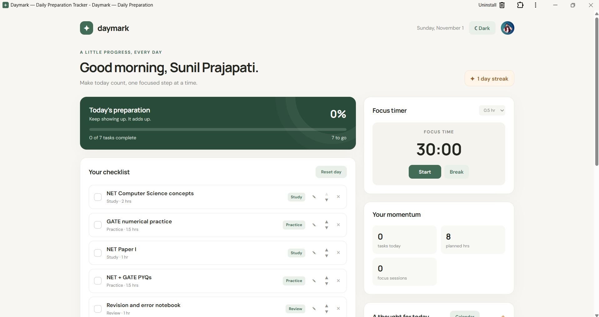
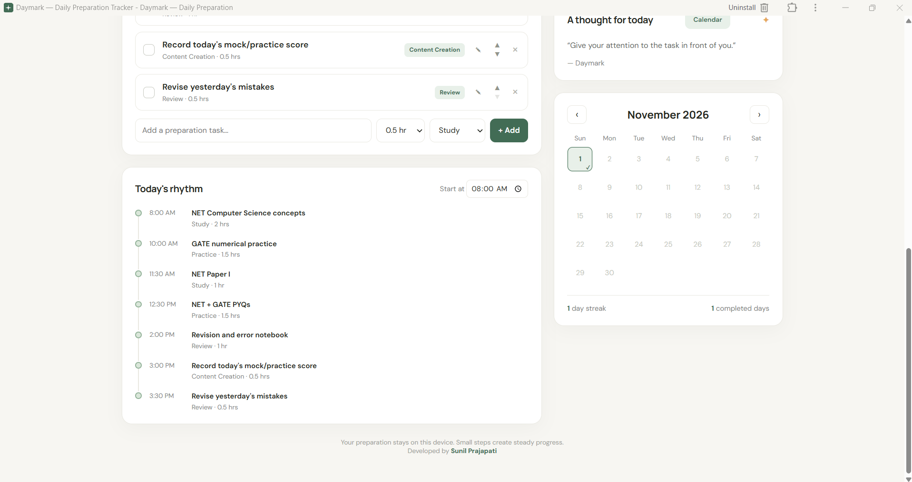
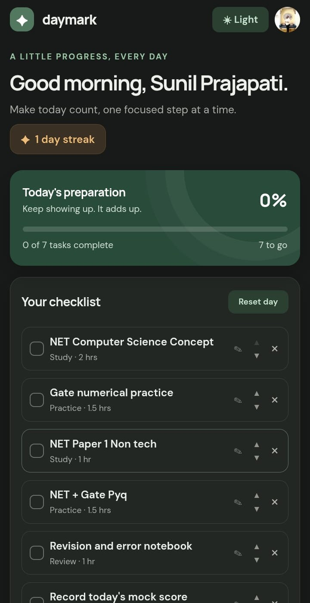
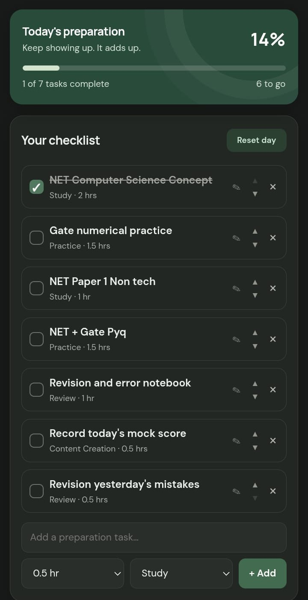
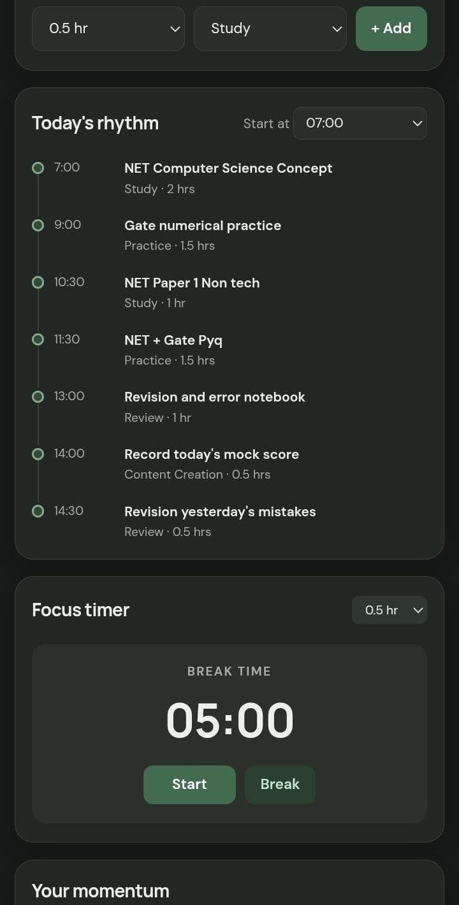
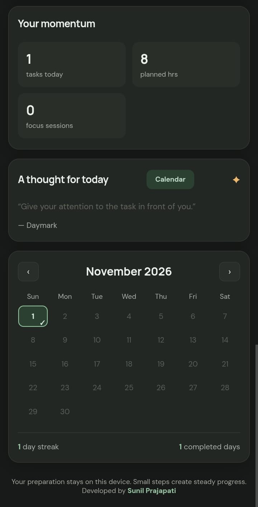

# Daymark — Daily Preparation Tracker

**Plan your day, focus on what matters, and build a steady preparation habit.**

Daymark is a free daily planner for desktop, tablet, and mobile. Open it in your browser, or install it on your phone’s home screen for an app-like experience. No account is required.

## Open Daymark

**Start using the app:** 

You can use Daymark directly in your browser. Installation is optional.

- **Android:** Open the app link in Chrome. Tap **Install** if it appears, or open Chrome’s menu and choose **Install app** or **Add to Home screen**.
- **iPhone:** Open the app link in Safari. Tap **Share → Add to Home Screen**, then tap **Add**. If offered, turn on **Open as Web App**.
- **Computer or tablet:** Open the app link in your browser. Daymark adjusts to your screen size.

For more detail, see the [Android install guide](https://github.com/sunilprajapati832/daymark/blob/main/ANDROID-INSTALL.md). The app is free to use; no subscription or payment is required.

## Preview

### Desktop — Light mode

### Mobile — Dark mode

<table>
  <tr>
    <td></td>
    <td></td>
    <td></td>
    <td></td>
  </tr>
</table>

## What you can do

- **Plan your checklist:** Add tasks, choose a category, estimate hours, and reorder items with the arrows. Edit or remove tasks whenever you need.
- **Make it personal:** Use a built-in category or choose **Other** and enter your own, such as sleep, play, or exercise.
- **See your day:** Daymark arranges tasks in checklist order and estimates their start times from the start time you choose.
- **Focus with a timer:** Choose a focus session from 30 minutes to 8 hours. The **Break** button switches to a 5-minute break.
- **Track completed days:** The calendar marks a day when every task in that day’s checklist is checked. It shows completed dates and your current consecutive-day streak.
- **Choose your look:** Switch between light and dark mode, and optionally add a display name and profile photo.
- **Get a daily reflection:** The thought changes daily and cycles through 100 original reflections before repeating.

## Quick start

1. Open the app link above.
2. Add your own task, or edit the sample tasks in **Your checklist**.
3. Set an estimated duration and category for each task.
4. Use the arrows to put tasks in your preferred order. **Today’s rhythm** updates to match.
5. Check tasks off as you complete them. Finish every task to mark that date complete in the calendar.

## How daily tracking works

- The calendar checks a date after all tasks on that day’s checklist are complete.
- Completed dates stay in your calendar when the checklist rolls over to a new day.
- A new day starts with the sample checklist. Add or edit tasks for that day as needed.
- The streak counts consecutive completed dates through today, or through yesterday if today is not complete yet.

## Your data and offline use

Daymark saves your tasks, completed dates, profile, and theme in your browser on that device. There are no accounts and no cloud sync, so data is separate on each device. Clearing the browser’s site data can remove your saved information.

After Daymark has loaded once while online, its app shell can reopen offline. The optional Google Fonts may not load without an internet connection; the app uses system fonts as a fallback.

## License

See the repository’s `LICENSE` file for the terms chosen by the owner. If the repository has no license file, the source remains under default copyright restrictions; GitHub’s public-repository terms still allow users to view and fork it.

## Feedback and suggestions

If you use Daymark, please share your review, report anything confusing or broken, and suggest features you’d like to see. You can leave feedback through the [GitHub repository](https://github.com/sunilprajapati832/daymark).

## About

Daymark is built with HTML, CSS, and JavaScript by **Sunil Prajapati** 
M.E. Graduate | Python & Flask Developer  

⭐ If you find this project valuable, feel free to star the repository and connect!
